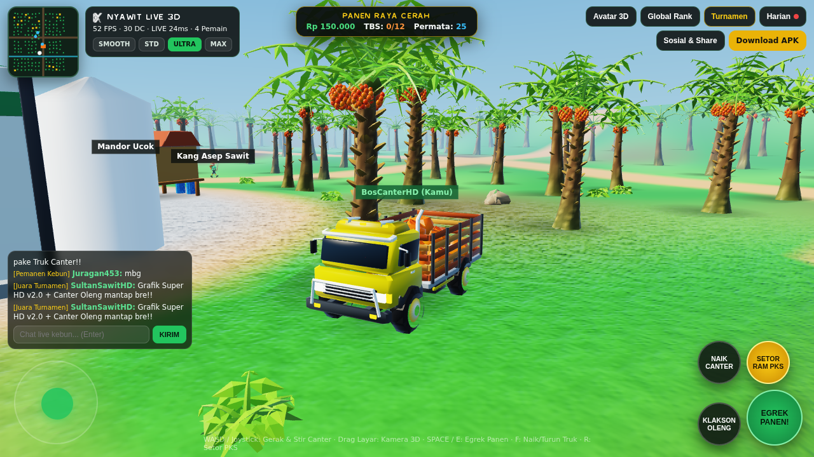
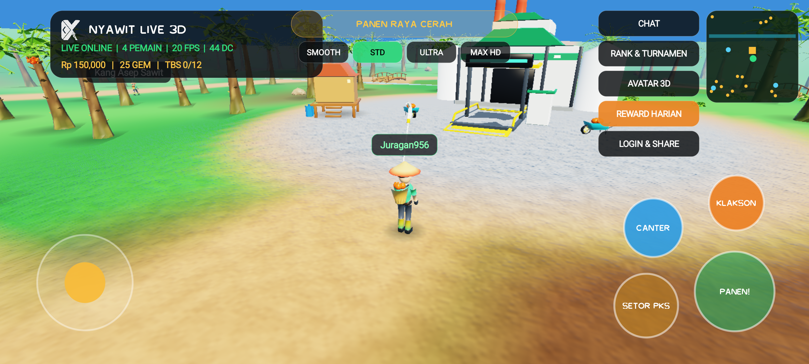
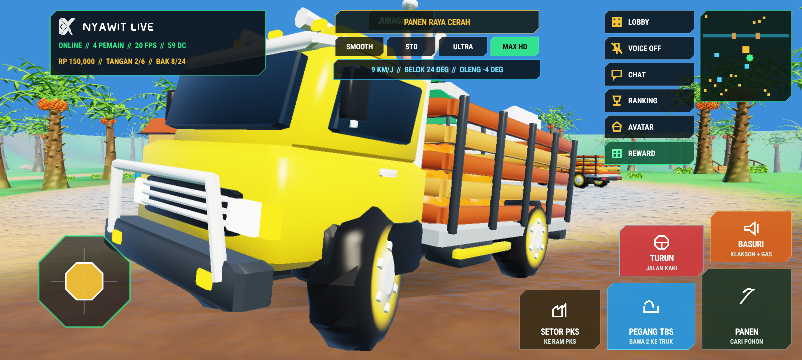

<div align="center">


# NYAWIT LIVE 3D — SUPER HD v2.0

**Multiplayer Open-World Oil Palm Plantation & Canter Haulage Game — Custom Native C# 3D Engine + Linear-Space PBR/ACES OpenGL ES 3.0 Instancing + Cross-Play WebGL2**

[](https://github.com/xykal/nyawit-live/actions/workflows/build-apk.yml)
[-22c55e?style=for-the-badge&logo=android&logoColor=white)](https://nyawit.xyverse.my.id/download/apk)
[](https://nyawit.xyverse.my.id)

</div>

---

## Live Gameplay & Sculpted 3D Asset Showcase (`v2.0 Super-HD`)

| Live Multiplayer Canter Oleng HD & Sculpted Oil Palms (`30 Draw Calls`) | Live PKS Plaza, Sultan Avatar & Real-Time Chat |
| :---: | :---: |
|  |  |

| Real Android 14 Emulator Verification — On-Foot Gameplay | Real Android 14 Emulator Verification — Canter Oleng Truck |
| :---: | :---: |
|  |  |

| Sculpted 3D Models & Multi-LOD Showcase (`87 Meshes / NPAK v2.0`) | Weekly Tournament & Global Ranking System |
| :---: | :---: |
|  |  |

---

## Key Features & v2.0 Engine Upgrades

1. **Zero Force-Close Android Architecture + Verified on Real Booted Android 14 (`API 34`) Emulator**
   - Universal native packaging across **`arm64-v8a`, `armeabi-v7a`, and `x86_64`** (`libnyawit_simd.so` + Mono runtime + preserved JNI marshaling constructors `(IntPtr, JniHandleOwnership)`).
   - Safe post-`SetContentView` fullscreen window-insets controller for Android 11–15 (`API 30–35`) and fallback-capable `SafeGles3ConfigChooser` (`4x MSAA -> 0x MSAA -> 16-bit depth`) across Qualcomm Adreno, ARM Mali, PowerVR, Samsung Xclipse, and emulator GPUs.
   - Automated CI hardware-KVM **Android 14 (`API 34`) Emulator** gate installs the signed universal APK via `adb install`, cold-boots `id.my.xyverse.nyawitlive`, injects multi-touch movement & Canter truck input, asserts **zero** `FATAL EXCEPTION` in `adb logcat`, and validates rendered frames before publishing any release.

2. **Super-HD Linear-Space PBR + ACES Filmic Graphics & Free-Fire Anti-Lag Scaling**
   - **3-Pass Custom OpenGL ES 3.0 & WebGL2 Pipeline**: atmospheric sky dome with glowing solar disc -> instanced soft ground contact shadows -> hardware-instanced (`glDrawElementsInstanced`) linear-space PBR lighting with ACES Filmic Tone Mapping, per-pixel procedural soil/grass/mud normal bump detail (`< 38m` zero-VRAM shader), backlit palm-frond subsurface scattering (SSS), rippling Fresnel canal water, and self-illuminated HDR LED emissives.
   - **Dynamic Hardware Resolution & Pixel Governor (`SMOOTH` `540p` / `STD` `720p` / `ULTRA` `900p` / `MAX HD` `1080p`)**: uses `GLSurfaceView.Holder.SetFixedSize` hardware scaling + `libnyawit_simd.so` frustum/3-LOD culling to hold **~14–31 GPU draw calls per frame** with automatic FPS step-down on budget phones ("HP Kentang").

3. **29 High-Craft Parametric Sculpted 3D Models (`NPAK v2.0` — `87` GPU Meshes)**
   - Spiral pruned petiole-scale `palm_trunk`, 4-whorl V-folded botanical `palm_crown`, 42-fruitlet `tbs_bunch`, detailed Mitsubishi-Colt-style `canter_truck_body` (slanted windshield, side mirrors, chrome grille, bullbar, exhaust snorkel, roof crown rack, wooden cargo slats, LED headlights/taillights), arched `wooden_bridge`, industrial `pks_factory` + `weighbridge_ram`, tusked `celeng_boar`, articulated human avatars, and 24K Sultan cosmetics with baked ambient occlusion & per-material gloss channels.

4. **Real-Time Open Kebun Sawit Multiplayer, Chat, Global Rank, Weekly Tournament & Social Share**
   - Authoritative Cloudflare Workers + **SQLite Durable Objects** (`wss://nyawit.xyverse.my.id/ws`) with seamless Android APK <-> WebGL2 cross-play, 3D speech bubbles, persistent global tonnage leaderboard, ISO-week tournaments, 7-day daily streak rewards, social account linking, and dynamic OpenGraph share cards (`/s/:code`).

---

## Local Build & Verification

```bash
# 1. Re-bake sculpted 3D NPAK v2.0 archive (29 models x 3 LODs = 87 meshes)
python3 tools/sculpt_pipeline.py

# 2. Run C# Engine automated unit & live WSS integration tests
dotnet test tests/NyawitEngine.Tests/NyawitEngine.Tests.csproj -c Release

# 3. Publish universal Android APK (arm64-v8a + armeabi-v7a + x86_64)
dotnet publish src/Nyawit.Android/Nyawit.Android.csproj -f net10.0-android -c Release -p:AndroidPackageFormat=apk
```

---

<div align="center">
  Built by <b>XyVerse Tech</b> · Live at <a href="https://nyawit.xyverse.my.id">https://nyawit.xyverse.my.id</a>
</div>
