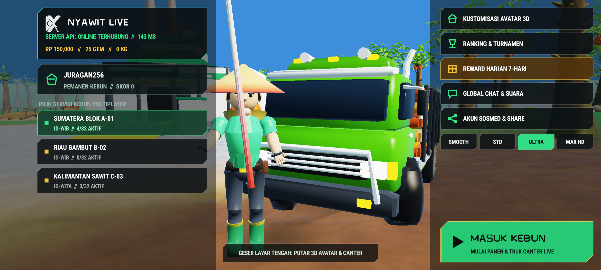
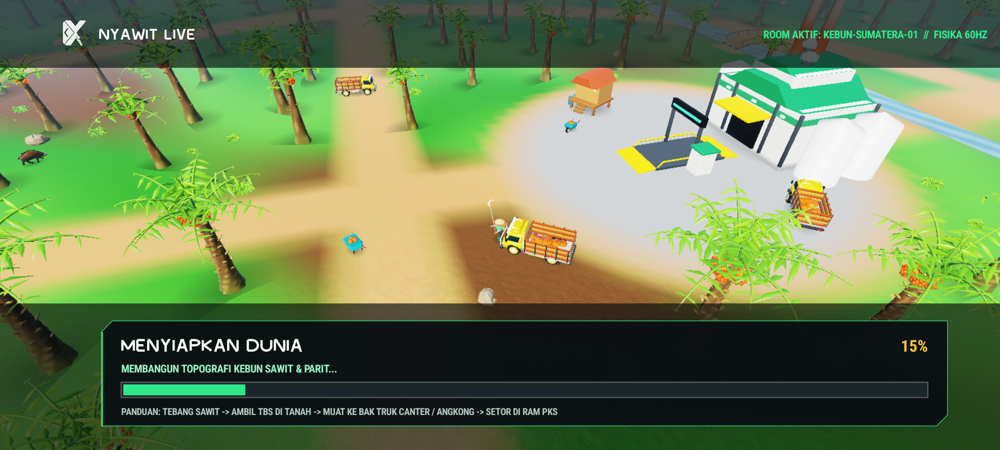
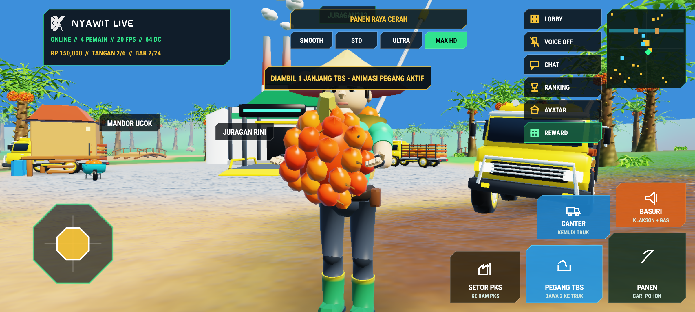

<div align="center">


# NYAWIT LIVE 3D — NATIVE ANDROID v3.0.0

**Native C# 3D Game Engine + OpenGL ES 3.0 Instancing + RigidBody Physics & 4-Wheel Suspension + Dedicated Multiplayer, Global Chat & Live Voice Server**

[](https://github.com/xykal/nyawit-live/actions/workflows/build-apk.yml)
[-22c55e?style=for-the-badge&logo=android&logoColor=white)](https://nyawit.xyverse.my.id/download/apk)
[](https://nyawit.xyverse.my.id)

</div>

---

## Live Android 14 (`API 34`) Hardware-KVM Verification & `NPAK v3.0` Showcase

| Interactive 3D Main Lobby Showcase (`Lobby` Stage) | Dedicated World Preparation Screen (`MENYIAPKAN DUNIA...`) |
| :---: | :---: |
|  |  |

| Detailed 11-Part Human Anatomy + Two-Handed TBS Hold + Sharp HUD | Canter Oleng 4-Wheel Suspension + `28 deg` Front Steering + Telemetry HUD |
| :---: | :---: |
|  |  |

| Watertight `NPAK v3.0` 3D Asset & Anatomy Sheet (`35 Models x 3 LODs = 105 Meshes, 0% Bolong`) |
| :---: |
|  |

---

## Architecture Highlights (`v3.0.0`)

1. **Pure Native Android Gameplay + Dedicated API/Multiplayer/Chat/Voice Domain (`https://nyawit.xyverse.my.id`)**
   - Browser WebGL gameplay is completely retired so client rendering and physics never diverge across platforms.
   - `https://nyawit.xyverse.my.id` operates strictly as the authoritative Cloudflare Workers + SQLite Durable Objects backend providing multi-room multiplayer sync (`wss://nyawit.xyverse.my.id/ws?room=...`), room directory (`/api/rooms`), global & room chat (`/api/chat`), live `8 kHz` G.711 u-law voice chat relay, global & weekly tournament leaderboards (`/api/leaderboard`), OpenGraph share cards (`/s/:code`), and direct signed APK distribution (`/download/apk`).

2. **Zero Mesh Holes (`0% Bolong-Bolong`) & Ultra-Detailed 11-Part Human Anatomy (`NPAK v3.0`)**
   - Every mirror/negative-scale transform in `tools/sculpt_pipeline.py` automatically detects negative determinants (`det(M) < 0`) and flips triangle winding (`idx[:, [0, 2, 1]]`), every lofted mesh enforces outward signed volume, open botanical fronds mark `double_sided = True`, and `Gles3InstancedRenderer.cs` applies `gl_FrontFacing ? n : -n` normal lighting.
   - Full hierarchical 11-part character rig (`BoneMat`): sculpted skull, jaw, ears, hair, eyebrows, whites + pupils, nose bridge, neck, V-tapered torso & belt, shoulders, upper arms, forearms, palms & thumbs/fingers, thighs, knees, calves, and tall plantation rubber boots.

3. **Solid RigidBody Physics (`0% Nembus`), 4-Wheel Spring-Damper Suspension & Action/Hold Animations**
   - `RigidBodyWorld` enforces solid circle/OBB push-out resolution against all `180` oil palms, boulders, canal banks, arched wooden bridge, Mandor post, `3` pushable Angkong wheelbarrows, Canter Sawit truck, RAM weighbridge, and PKS factory buildings.
   - Four independent wheel spring-damper rays compute suspension compression, wheel spin velocity, `28 deg` front wheel steering angle, and dynamic chassis pitch/roll ("Canter Oleng").
   - Full procedural animation state machine: idle breathing, knee-flex sprinting, two-handed Egrek/Dodos grip & slash, deep squat pickup of fallen spiky TBS from ground, cradling TBS in both hands, parabolic throw into the Canter cargo bed or Angkong cart, pushing Angkong handles, and seated Canter driver steering pose.

4. **Sharp Chamfered Tactical HUD, Custom Vector Icons (`Zero Emojis`), Upgraded Tactile Click/Gameplay SFX & Live Voice**
   - `100%` chamfered polygon UI panels (`DrawChamferedPanel`), octagonal movement pad (`DrawOctagonPad`), sharp square minimap (`DrawSharpMinimap`), and `17` procedural geometric vector icons (`DrawVectorIcon`) — verified zero Unicode emojis across the entire codebase via CI check.
   - `14` procedurally synthesized `44.1 kHz` PCM SFX clips (crisp `ui_click` & `ui_open` on every tap, footsteps, Egrek slash, TBS bounce/pickup/throw, suspension bump, Basuri horn, RAM cashout) plus live `8 kHz` microphone voice chat (`AudioRecord` / `AudioTrack`).

---

## Local Build & Verification

```bash
# 1. Generate watertight NPAK v3.0 archive (35 models x 3 LODs = 105 meshes)
python3 tools/sculpt_pipeline.py

# 2. Run C# Engine unit tests (RigidBody collisions, suspension, NPAK v3.0 & live WSS)
dotnet test tests/NyawitEngine.Tests/NyawitEngine.Tests.csproj -c Release

# 3. Publish universal Android APK (arm64-v8a + armeabi-v7a + x86_64)
dotnet publish src/Nyawit.Android/Nyawit.Android.csproj -f net10.0-android -c Release -p:AndroidPackageFormat=apk
```

---

<div align="center">
  Built by <b>XyVerse Tech</b> · Dedicated Server & Official APK Portal at <a href="https://nyawit.xyverse.my.id">https://nyawit.xyverse.my.id</a>
</div>
