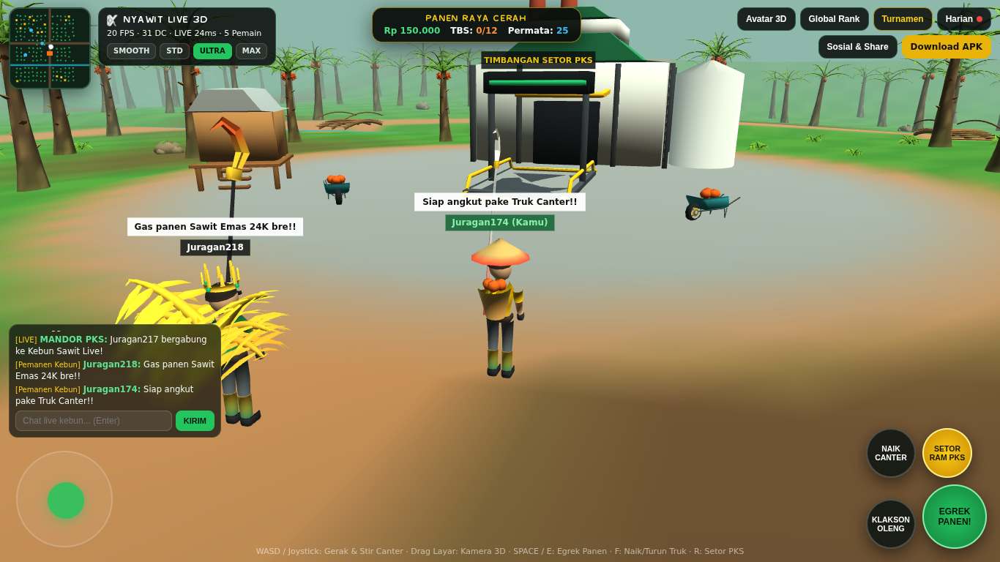
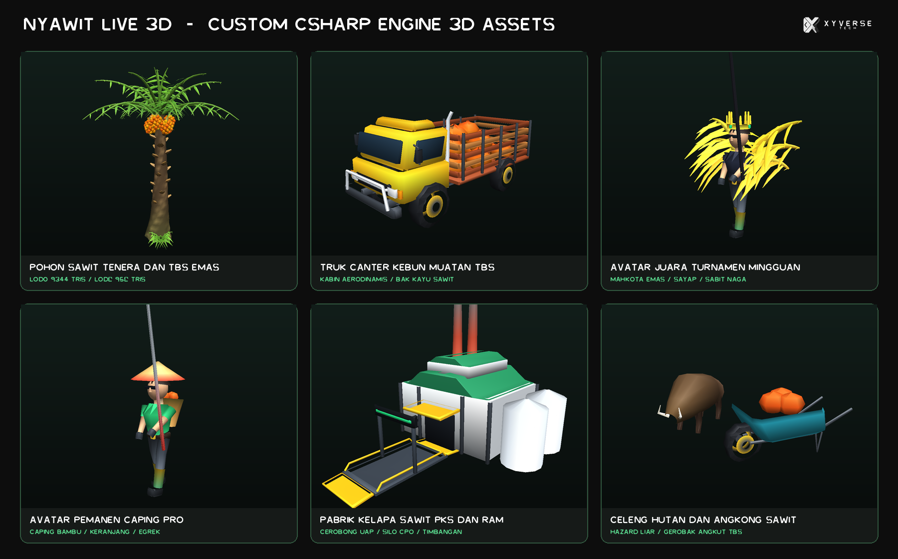
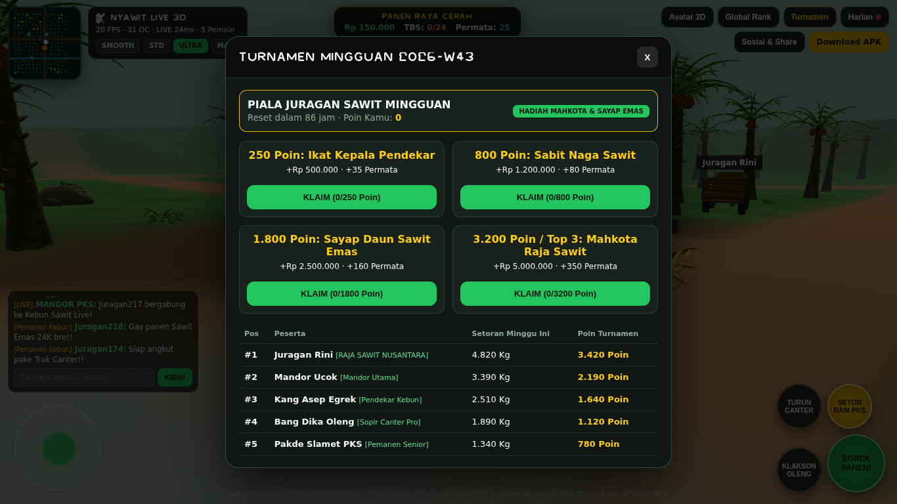

<div align="center">


# NYAWIT LIVE 3D

**Multiplayer Open-World Oil Palm Plantation & Canter Haulage Game — Custom Native C# 3D Engine + OpenGL ES 3.0 Hardware Instancing + Cross-Play WebGL2**

[](https://github.com/xykal/nyawit-live/actions/workflows/build-apk.yml)
[-22c55e?style=for-the-badge&logo=android&logoColor=white)](https://nyawit.xyverse.my.id/download/apk)
[](https://nyawit.xyverse.my.id)

</div>

---

## Live Gameplay & Sculpted 3D Asset Showcase

| Live Multiplayer Canter Truck & Golden Avatar (`31 Draw Calls`) | Live PKS Plaza & Real-Time Speech Bubbles |
| :---: | :---: |
|  |  |

| Sculpted 3D Models & Multi-LOD Showcase (`87 Meshes / NPAK v1`) | Weekly Tournament & Global Ranking System |
| :---: | :---: |
|  |  |

---

## Key Features

1. **Custom Native C# 3D Game Engine (`NyawitEngine` + `libnyawit_simd.so` + OpenGL ES 3.0)**
   - Built from scratch in **Native C# (`.NET 8`)** with a Unity-style scene architecture (`Scene`, `GameObject`, `Transform`, `Component`, `MonoBehaviour` lifecycle) paired with a native **C11 / ARM NEON** frustum & multi-LOD culler (`native/nyawit_simd.c`) and zero-allocation `GLES30.GlDrawElementsInstanced` batching.
   - **Complex Sculpted 3D Geometry (Zero Box/Sphere Primitives)**: `tools/sculpt_pipeline.py` generates **29 detailed parametric 3D models x 3 LOD tiers (`87` meshes, `33,622` hero triangles)** packed into a single `3.86 MB` interleaved binary archive (`nyawit_models.npak`, 36-byte vertex stride + dye-mask UV channel).
   - **Free Fire-Class Mobile Optimization (`SMOOTH` / `STD` / `ULTRA` / `MAX HD`)**: renders 180 swaying Tenera oil palms, hanging ripe & 24K golden TBS bunches, falling physics bunches, Canter Sawit trucks, angkong carts, wooden canal bridges, PKS factory silos, RAM weighbridge, wild boars, and articulated multi-part player avatars in **~14–31 GPU draw calls per frame**, with an automatic FPS governor that steps down render scale & foliage range on budget Android phones ("HP Kentang").

2. **Real-Time Open Kebun Sawit Multiplayer & Cross-Play (`wss://nyawit.xyverse.my.id/ws`)**
   - Authoritative Cloudflare Workers + **SQLite Durable Objects** (`PlantationHub`) running 10 Hz world state broadcast, server-authoritative TBS harvesting & regrowth timers, dynamic world weather/rush events (`Panen Raya Cerah`, `Demam Sawit Emas 24K`, `Hujan Badai Petir`), and seamless cross-play between the **Native Android APK** and **WebGL2 Browser Client**.

3. **Real-Time Global & Room Chat + 3D Speech Bubbles**
   - Instant multiplayer chat dock, 1-tap quick-chat callouts, Mandor PKS live announcements, and projected speech bubbles floating directly above players' heads in 3D space.

4. **Persistent Global Ranking & Weekly Tournament System**
   - All-time global tonnage & score leaderboard persisted in Durable Object SQLite storage.
   - Automatic ISO-week **Weekly Tournament** with live countdown timer, weekly leaderboard standings, and 4 progressive reward tiers unlocking exclusive 3D items (`Ikat Kepala Pendekar`, `Sabit Naga Sawit`, `Sayap Daun Sawit Emas`, `Mahkota Raja Sawit 24K`).

5. **Real-Time 3D Avatar & Canter Paint Customization**
   - Customize player display name, 5 sculpted 3D hats, 4 sculpted 3D back accessories, 3 harvesting tools (`Egrek`, `Dodos`, `Sabit Naga 24K`), and 8 outfit/truck paint colors — synced immediately to every player in the plantation.

6. **7-Day Daily Login Streak & Social Login / 1-Tap Achievement Sharing**
   - Daily streak calendar awarding Rupiah, Gems, and permanent harvesting sell-price multipliers.
   - Social account linking (`Google`, `TikTok`, `Instagram`, `X`, `WhatsApp`) plus one-tap **Dynamic OpenGraph Achievement Share Cards** (`/api/share` -> `https://nyawit.xyverse.my.id/s/:code`) integrated with the native Android Share Sheet (`Intent.ActionSend`).

---

## Project Architecture

```text
nyawit-live/
├── native/
│   └── nyawit_simd.c                # C11 / ARM NEON frustum & 3-tier LOD batch culler -> libnyawit_simd.so
├── src/
│   ├── NyawitEngine/                # Custom C# 3D Game Engine Core (.NET 8, zero-reflection & trimmer-safe)
│   │   ├── Assets/NpakLoader.cs     # Binary NPAK v1 87-mesh loader & verified MeshCatalog constants
│   │   ├── Core/SceneGraph.cs       # Scene, GameObject, Transform, MonoBehaviour & Free-Fire QualityGovernor
│   │   ├── Math/EngineMath.cs       # Zero-GC TRS matrix packer, screen projector & P/Invoke SIMD bridge
│   │   ├── Network/LiveMultiplayerClient.cs # Utf8JsonWriter WebSocket client + offline fallback mode
│   │   └── World/PlantationWorld.cs # Deterministic 180-palm layout, splatted terrain & canal builder
│   └── Nyawit.Android/              # Lightweight Native Android Client (OpenGL ES 3.0 + AudioTrack SFX)
│       ├── Rendering/Gles3InstancedRenderer.cs # Hardware-instanced ES 3.0 renderer & physics loop
│       ├── UI/HudOverlayView.cs     # 60/120Hz Canvas HUD, virtual analog stick, minimap & nameplates
│       ├── Audio/ProceduralSfxPlayer.cs # Zero-asset PCM audio synthesizer
│       └── MainActivity.cs          # Fullscreen activity, prefs persistence & native modals / Share Sheet
├── server/                          # Live Multiplayer Backend & WebGL2 Cross-Play Client (Cloudflare Workers)
│   ├── src/worldSpec.js             # Deterministic world math shared identically with C# PlantationWorld
│   ├── src/worker.js                # Authoritative PlantationHub SQLite Durable Object & REST/Share endpoints
│   └── public/                      # Zero-CDN WebGL2 instanced client + XyVerse brand assets
├── tools/
│   ├── sculpt_pipeline.py           # Parametric 3D sculptor & NPAK v1 binary baker (29 models x 3 LODs)
│   └── render_showcase.py           # Studio showcase, launcher icon & OpenGraph banner renderer
├── tests/
│   └── NyawitEngine.Tests/          # Automated xUnit verification suite (NPAK, LODs, Governor, Live WSS)
└── .github/workflows/build-apk.yml  # Automated NDK + .NET 8 Android Signed Universal APK CI/CD workflow
```

---

## Local Build & Verification

### 1. Environment Setup
Copy `.env.example` to `.env` for local configuration (`.env` is gitignored and never committed):
```bash
cp .env.example .env
```

### 2. Run C# Engine Automated Tests
```bash
dotnet test tests/NyawitEngine.Tests/NyawitEngine.Tests.csproj -c Release
```

### 3. Build Universal Signed Android APK (`arm64-v8a` + `armeabi-v7a`)
```bash
dotnet publish src/Nyawit.Android/Nyawit.Android.csproj -f net8.0-android -c Release -p:AndroidPackageFormat=apk
```

### 4. Re-bake Sculpted 3D Models (`nyawit_models.npak`) & Run Server Locally
```bash
python3 tools/sculpt_pipeline.py
cd server && npm install && npm run dev
```

---

<div align="center">
  Built by <b>XyVerse Tech</b> · Live at <a href="https://nyawit.xyverse.my.id">https://nyawit.xyverse.my.id</a>
</div>
