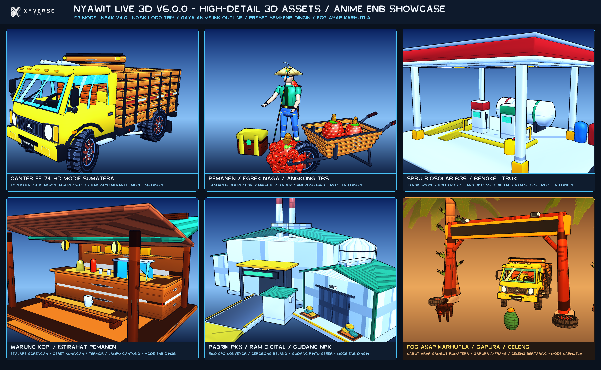

# NYAWIT LIVE 3D — `v6.0.0` (57-Model High-Detail Anime Outline Edition, `Semi-ENB Dingin` & `Fog Asap Karhutla`, C11 SIMD Culler & Real-Player Multiplayer)

**Custom Native C# OpenGL ES 3.0 Instanced Cel-PBR + Anime Outline 3D Engine · `57` High-Detail Sculpted 3D Models (`171` LOD Meshes, `60,556` LOD0 Tris) · `Semi-ENB Dingin` & `Fog Asap Karhutla` Atmospheres · Native C11 6-Plane Frustum Culler · `220` Mature Palms + `96` Juvenile Saplings · Authentic Canter Arrow + Gas/Brake Pedal Controls · 100% Real-Player Dedicated Multiplayer & Live Voice Server**

- **Live Dedicated Multiplayer, Global Chat & Voice Server Portal**: <https://nyawit.xyverse.my.id>
- **Per-ABI Signed Android APKs (`v6.0.0`: `arm64-v8a`, `armeabi-v7a`, `x86_64`)**:
  - `ARM64-v8a` (Modern Android phones): <https://nyawit.xyverse.my.id/download/apk/arm64-v8a>
  - `armeabi-v7a` (32-bit ARM devices): <https://nyawit.xyverse.my.id/download/apk/armeabi-v7a>
  - `x86_64` (Chromebooks & Android 14 Emulators): <https://nyawit.xyverse.my.id/download/apk/x86_64>
- **Official GitHub Releases**: <https://github.com/xykal/nyawit-live/releases/latest>



---

## Verified Live Hardware Android 14 (`API 34`) Captures (`2400x1080` Fullscreen Immersive)

Every build of **Nyawit Live 3D `v6.0.0`** boots inside an **Android 14 (`API 34`)** emulator in CI with **zero stock Android widgets/bars/dialogs** and verifies all **7 engine stages** in one uninterrupted process PID:

1. **Custom `XYVERSE TECH` Boot Splash & Shader/Atlas Warm-Up** (`57 MODEL 3D`)
2. **Dedicated Separate 3D Garage / Workshop Showroom Lobby (`GARASI SAWIT`)** — `360°` turntable camera, Anime Ink Outline + `Semi-ENB Dingin` lighting, harvester outfit selector, and hollow-cabin **Mitsubishi Fuso Canter FE 74 HD Modif Sumatera**
3. **Full-Screen `"MENYIAPKAN DUNIA"` World Streaming Stage** (`220 POHON SAWIT`)
4. **Expanded Plantation On-Foot Gameplay (`Semi-ENB Dingin`)** — `220` harvestable oil palms, `96` inter-row saplings, `SPBU Solar`, `Warung Kopi`, `Gudang Pupuk`, `Gapura Offroad`, `5.06m` telescopic Egrek harvest animation, falling fronds, and spiky TBS two-hand carry
5. **Mitsubishi Fuso Canter FE 74 HD Driving (`Semi-ENB Dingin` + Anime Outline)** — default `[KIRI]`/`[KANAN]` steering arrows + `[GAS]`/`[REM]` pedals, leaf-spring axles, spinning driveshaft, persistent mud tire tracks, and dual rear tires
6. **Peatland Smoke Atmosphere (`Fog Asap Karhutla` + Halogen Headlights)** — authentic Indonesian Sumatra/Kalimantan smoky amber haze, drifting smoke motes, automatic Canter halogen headlight beams, and crisp Anime ink silhouettes
7. **Custom In-Game `PENGATURAN` Modal** — `MOOD GRAFIK & ENB` (`ENB DINGIN`, `ASAP KARHUTLA`, `TROPIK CERAH`), `GARIS OUTLINE ANIME` (`MATI`, `HALUS`, `ANIME TEGAS`), `30–120 FPS`, shadow tier, and `"PANAH + GAS/REM"` vs `"JOYSTICK ANALOG"`

---

## Key Engineering Highlights in `v6.0.0`

| Subsystem | Implementation Details |
| :--- | :--- |
| **Anime Ink Outline + `Semi-ENB Dingin` & `Fog Asap Karhutla` (`Gles3InstancedRenderer.cs`)** | Zero-upload inverted-hull (`GL_CULL_FACE` + `GL_FRONT`) silhouette ink outlines paired with hybrid cel-shaded ACES-tonemapped PBR lighting, cool steel-cyan `Semi-ENB Dingin` grading, and smoky amber `Fog Asap Karhutla` peatland haze with automatic halogen headlight beams. |
| **Native C11 SIMD 6-Plane Frustum Culler & `60–120 FPS` Pipeline** | `native/nyawit_simd.c` extracts 6 normalized Gribb-Hartmann frustum planes from `ViewProj` and culls world instances across 3 LOD tiers (`LOD0`, `LOD1`, `LOD2`) with zero per-frame GC allocations; single `2048x2048` trilinear-mipmapped PBR texture atlas + hardware OpenGL ES 3.0 instancing (`glDrawElementsInstanced`) + per-ABI native `.so` packaging (`~22–24 MB` per APK). |
| **57 High-Detail Procedural PBR 3D Models (`nyawit_models.npak`)** | `57` watertight UV-mapped models × `3` LODs = `171` meshes (`3.64 MB` binary archive, `60,556` LOD0 triangles): hollow-cabin **Mitsubishi Fuso Canter FE 74 HD Modif Sumatera** with chrome grille, roof rack, cab steps, dual exhausts, 7-lug deep-dish steel rims, leaf-spring axle suspension, spinning driveshaft & headlight cones, `5.06m` telescopic `Egrek` & `Egrek Naga`, neutral/strain facial expressions, `SPBU Solar`, `Warung Kopi`, `Gudang Pupuk`, `Pabrik PKS`, `Timbangan RAM`, and `Gapura Offroad`. |
| **Authentic Canter Pedals + Telescopic Egrek Gameplay** | Multi-touch `[KIRI]`/`[KANAN]` arrow steering + `[GAS]`/`[REM]` pedals (with automatic air-brake into smooth reverse gear and optional `JOYSTICK ANALOG` mode in `PENGATURAN`), contextual `ISI SOLAR TURBO` & `NGOPI STAMINA` estate stations, and custom Canvas QWERTY text entry (`0` stock Android UI widgets, `0` emojis). |
| **100% Real-Player Dedicated Multiplayer & Voice Relay (`nyawit.xyverse.my.id`)** | Cloudflare Workers + Durable Objects (`PlantationHub` SQLite) running 100% real-player-only room state sync (zero simulated bots, zero seeded fake accounts), live `8 kHz` u-law push-to-talk voice relay, token-authenticated `/api/share` social cards, and per-ABI `/download/apk/<abi>` routing. |

---

## Repository Structure

```text
nyawit-live/
├── native/nyawit_simd.c               # C11 / NEON 6-plane Gribb-Hartmann frustum culler + 3-tier LOD selector
├── src/
│   ├── NyawitEngine/                  # Pure C# 3D engine core (57-model NPAK loader, RigidBodyWorld, SimdCuller, PlantationWorld, LiveMultiplayerClient)
│   └── Nyawit.Android/                # Native .NET 10 Android client (GLES 3.0 shadow+PBR instanced renderer, zero-widget Canvas HUD & QWERTY modal, voice/SFX)
├── server/                            # Cloudflare Worker + Durable Object SQLite real-player multiplayer, chat & voice server (nyawit.xyverse.my.id)
├── tools/
│   ├── sculpt_pipeline.py             # Generates 57 UV-mapped 3D models x 3 LODs (171 meshes) -> nyawit_models.npak
│   └── verify_android_emulator.py     # Automated 6-stage Android 14 (API 34) hardware verification harness
├── tests/NyawitEngine.Tests/          # xUnit physics, landmark collision, 6-plane SIMD frustum & 57-mesh NPAK verification suite
└── .github/workflows/                 # Per-ABI APK build, Android 14 live 6-stage emulator verification & release pipelines
```
